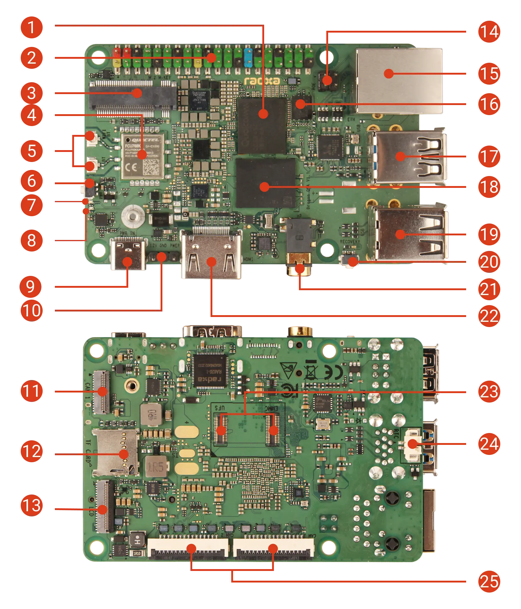

# Аппаратный справочник Radxa Dragon Q6A

Официальные материалы изучены **23 сентября 2026 года**.
Конфигурация владельца — **12 ГБ ОЗУ и NVMe 512 ГБ** —
зафиксирована в [описании платы](../README.md).
Ниже приведены характеристики производителя, а не результаты испытаний.
Перед подключением периферии нужно сверить фактическую PCB
с сохранёнными документами **V1.21**.

## Плата и интерфейсы

Номера соответствуют [официальному описанию интерфейсов](https://docs.radxa.com/en/dragon/q6a/hardware-use/hardware-info).
Это иллюстрация производителя, а не фотография имеющегося экземпляра.

| Узел | Характеристики и ограничения |
| --- | --- |
| Вычислительная часть | Qualcomm QCS6490: восемь ядер CPU, GPU Adreno 643; LPDDR5. Для имеющегося экземпляра владелец указал 12 ГБ ОЗУ. |
| Загрузочная прошивка (16) | QSPI NOR 32 МБ; загрузка по умолчанию начинается отсюда. Накопитель с ОС и BIOS — отдельные компоненты. |
| NVMe (3) | M.2 M Key **2230**, **PCIe Gen3 x2**. Модель SSD на 512 ГБ и измеренная производительность не указаны. |
| Сменные накопители (12, 23) | microSD и комбинированный разъём для **eMMC или UFS**. Нужен модуль, совместимый с Q6A; это не универсальный разъём для телефонной памяти. |
| Сеть (4, 5, 14, 15) | Gigabit Ethernet; Wi-Fi 6 / Bluetooth 5.4 с подключением внешних антенн; для PoE нужна отдельная плата HAT. |
| USB (17, 19) | Один порт USB 3.1 Type-A host/OTG — **нижнее гнездо под номером 17**; три порта USB 2.0 Type-A host. USB-C (9) служит для питания. |
| Дисплей (13, 22) | Четырёхлинейный MIPI DSI и HDMI; заявлено до 4K30. Для работы без графического рабочего стола они не обязательны. |
| Расширение (2, 24) | 40-контактный GPIO-разъём с мультиплексированными последовательными интерфейсами; разъём батареи RTC. Назначение контактов зависит от дерева устройств. |
| Механика | PCB **85 × 56 мм**, расстояние между центрами монтажных отверстий **58 × 49 мм**, четыре отверстия **3,5 мм** по сохранённому чертежу. Разъёмы, SSD, радиатор и кабели требуют дополнительного места. |

Источники: [обзор](https://docs.radxa.com/en/dragon/q6a),
[NVMe](https://docs.radxa.com/en/dragon/q6a/hardware-use/nvme),
[eMMC/UFS](https://docs.radxa.com/en/dragon/q6a/hardware-use/ufs-emmc-com),
[USB](https://docs.radxa.com/en/dragon/q6a/hardware-use/usb)
и [механический чертёж](../docs/radxa-q6a-dimensions-v1.21.pdf).

## Камерные разъёмы

| Разъём на схеме V1.21 | Физический интерфейс | Электрические особенности |
| --- | --- | --- |
| **J14 / CAM 1** (номер 11 на иллюстрации) | **31 контакт, шаг 0,3 мм**, четыре линии данных CSI | Подтяжки I2C и CAM0_POWER_EN подключены к **1,8 В**; у reset есть необязательная подтяжка к 1,8 В. Выведены питания 3,3 В и 5 В, но они не определяют напряжение управляющей шины. |
| **J16 / CAM 2**, **J7 / CAM 3** (номер 25 на иллюстрации) | По **15 контактов, шаг 1,0 мм**, две линии данных CSI; Radxa описывает распиновку как совместимую с Raspberry Pi | I2C/reset проходят через преобразователи **1,8 В ↔ 3,3 В**; питание на разъёме — 3,3 В. В цепях XCLK есть необязательные резисторы; важны установленные компоненты и источник тактового сигнала камеры. |

Эти соединения описаны в [руководстве по CSI](https://docs.radxa.com/en/dragon/q6a/hardware-use/mipi-csi)
и на **странице 32 PDF, печатном листе 34/37, CAM**.
Нумерация страниц PDF и листов схемы различается. Перед использованием
переходника нужно проверить номера контактов, ориентацию шлейфа,
напряжения питания и управления, тактовые сигналы и соединения CSI.
Таблица не задаёт схему переходника AR0234;
см. [план камерного эксперимента](../camera-research.md#эксперимент-с-ar0234).

## Питание и последовательная консоль

Radxa рекомендует источник **USB-C PD 12 В, не менее 2 А**.
Альтернативный трёхконтактный вход: **1 = 12 В, 2 = GND, 3 = PWR**.
PWR — вход кнопки, а не дополнительный контакт питания.
PoE требует отдельного расширения.
См. [руководство по питанию](https://docs.radxa.com/en/dragon/q6a/hardware-use/power-header).

Для [отладочного UART](https://docs.radxa.com/en/dragon/q6a/system-config/uart-debug)
используются физические номера контактов:

| Контакт платы | Подключение USB-UART |
| --- | --- |
| 6, GND | GND |
| 8, TX платы | RX адаптера |
| 10, RX платы | TX адаптера |

Параметры: **TTL 3,3 В**, **115200, 8N1**, без управления потоком.
Плата питается от собственного источника; провод питания адаптера
не подключается. На странице 24 схемы V1.21 в PDF
(печатный лист 26/37) показаны `DBG_UART_TX_3V3` / `RX_3V3`
на J20 и преобразователь U47. Страница Radxa по UART называет его UART0,
а таблица GPIO обозначает контакты 8/10 как UART5. Определять устройство
`/dev/tty*` нужно по физическим контактам и фактической ОС.

[Таблица GPIO](https://docs.radxa.com/en/dragon/q6a/hardware-use/pin-gpio)
содержит идентификаторы Qualcomm GPIO и физические номера контактов.
Указанный в примере `/dev/gpiochip4` не является стабильным обозначением
для разных Ubuntu, Armbian и версий ядра. Перед проверкой периферии
нужно зафиксировать фактическое соответствие.

## Навигация по сохранённым чертежам

- [Схема](../docs/radxa-q6a-schematic-v1.21.pdf): страница PDF 2 —
  блок-схема; 14 — eMMC/UFS; 24 — GPIO и отладочный UART;
  31 — M.2; 32 — камеры.
- [Размещение компонентов](../docs/radxa-q6a-components-v1.21.pdf):
  страница 1 — верхняя сторона, 2 — нижняя; разъёмы определяются
  по позиционным обозначениям и ориентации.
- [Размеры](../docs/radxa-q6a-dimensions-v1.21.pdf): верхняя и нижняя стороны.
- [Происхождение материалов](../docs/README.md): исходные URL,
  версии, дата получения, контрольные суммы и объём проверки.
